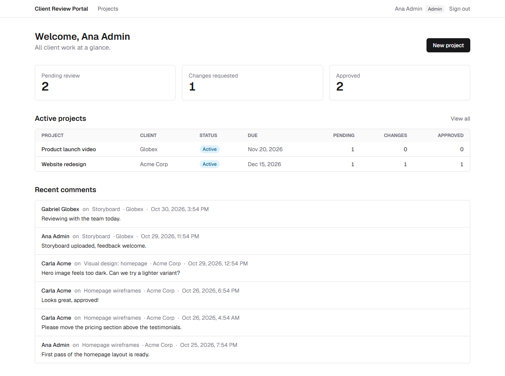
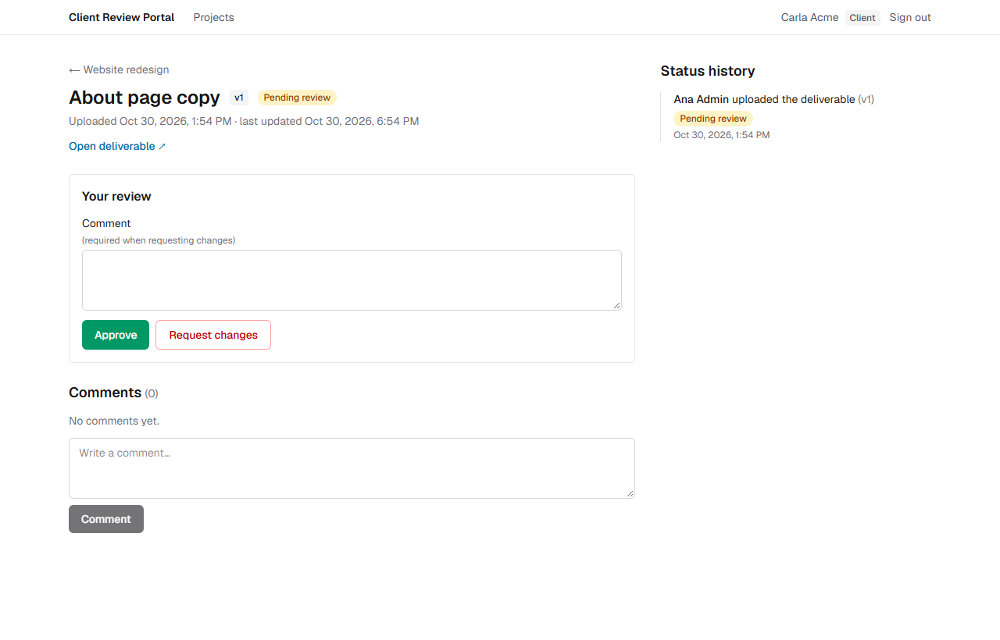
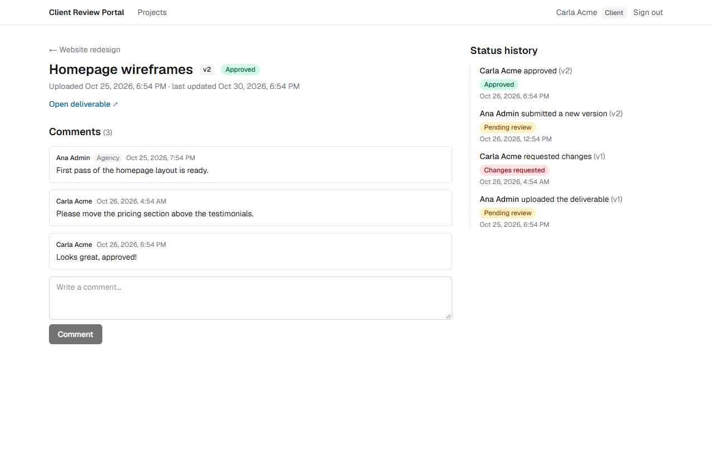
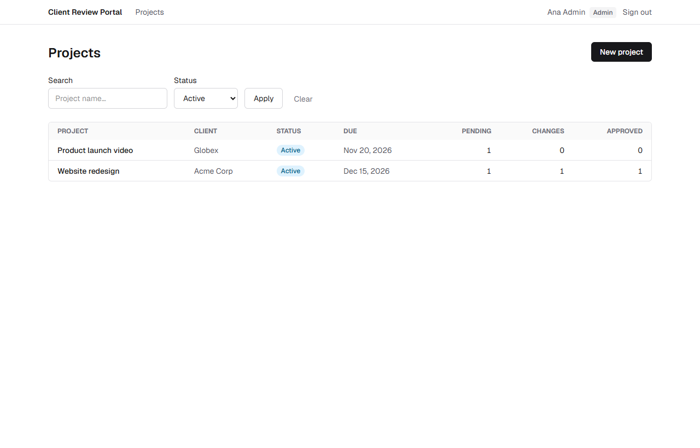
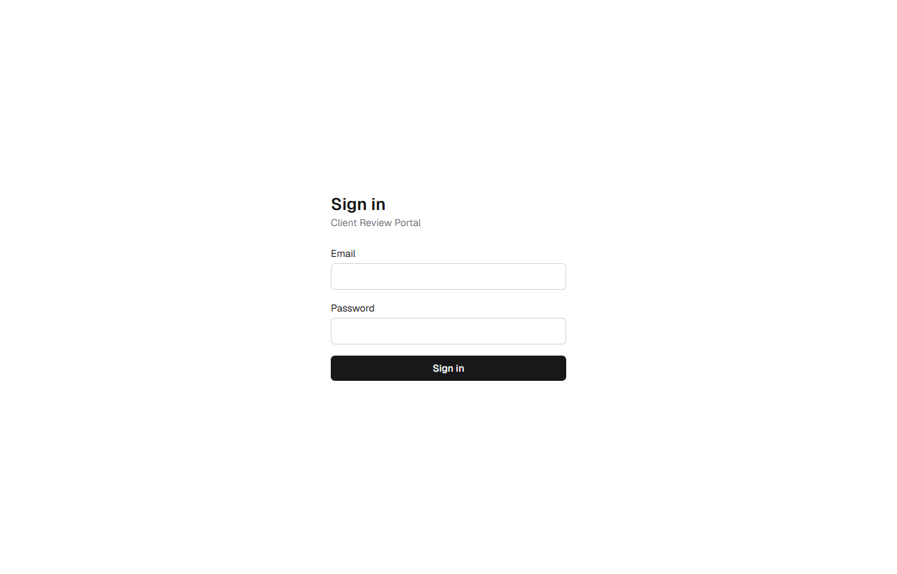
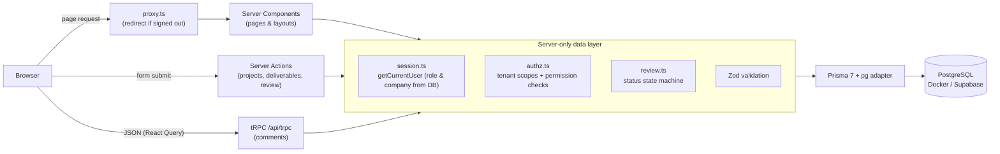

# Client Review Portal

[](https://github.com/Juaned2021/client-review-portal/actions/workflows/ci.yml)

A small, production-minded **client review & production portal**: an agency uploads deliverables for client projects, and each client reviews them (approve or request changes) and discusses them in a comment thread. Every client sees **only their own company's data**, enforced on the server for every query and mutation.

> Built as a learning project to practice Next.js App Router.



| Client review panel | Status history & versions |
|---|---|
|  |  |
| **Projects filtered by status (URL search params)** | **Sign in** |
|  |  |

## Features

- **Auth:** email + password (Auth.js v5 Credentials, bcrypt, JWT sessions). `proxy.ts` redirects anonymous users.
- **Admin (agency):** dashboard across all clients (one SQL query with `JOIN`s and `COUNT … FILTER` aggregates), create projects and deliverables, submit new versions, see every comment.
- **Client:** sees only their company's projects and deliverables, approves or requests changes (a comment is required), comments.
- **Deliverable page:** details, version, link, review panel, status history from an audit log, and a comment thread with **optimistic updates** (tRPC + TanStack Query).
- **Filtering & search** stored in URL search params and rendered on the server (`/projects?status=ACTIVE&q=web`).
- `loading.tsx`, `error.tsx` and `not-found.tsx`, with a real **404** (not 403) for other tenants' IDs.

## Architecture



- **Server Components by default.** Pages load their own data, already scoped to the user's company. `"use client"` appears only where the browser is required, and each such file has a comment explaining why.
- **Server Actions** for forms (they work without client JS); **tRPC** for the interactive comment thread.
- **One authorization module** (`src/server/authz.ts`). Every read composes a tenant scope, and every mutation re-checks permissions on the server.

Why each choice was made: **[docs/DECISIONS.md](docs/DECISIONS.md)**.

## Tech stack

| Layer | Choice |
|---|---|
| Framework | Next.js 16 (App Router, Turbopack), React 19, TypeScript (strict) |
| Styling | Tailwind CSS v4 |
| Database | PostgreSQL 16, Prisma ORM 7 (`@prisma/adapter-pg`) |
| Auth | Auth.js (NextAuth v5) Credentials + bcrypt, JWT sessions |
| API | Server Actions + tRPC v11 with TanStack Query |
| Validation | Zod 4 |
| Tests | Vitest (unit + integration against real Postgres) |
| CI | GitHub Actions: lint, typecheck, tests, build, migrations from scratch, drift check |

## Data model

`Client` 1─* `User` · `Client` 1─* `Project` 1─* `Deliverable` 1─* `Comment` *─1 `User` · `ActivityLog` (audit trail)

- Instants are `timestamptz(6)`; due dates are `date` (handled as `YYYY-MM-DD`, so they never shift a day across time zones).
- Every foreign key is indexed; `onDelete` rules are deliberate (`Restrict` to protect client work, `Cascade` for project → deliverables → comments, `SetNull` to keep the audit trail).
- Hand-written `CHECK` constraints: admin ⇔ no company, lowercase emails, non-blank comments, positive versions.

## Run locally

Requirements: Node.js ≥ 20.9 (24 recommended), Docker Desktop.

```bash
git clone https://github.com/Juaned2021/client-review-portal.git
cd client-review-portal
cp .env.example .env            # then set AUTH_SECRET (see below)
npm install                     # also runs `prisma generate`
npm run db:up                   # Postgres 16 in Docker (set POSTGRES_PORT=5433 if 5432 is busy)
npx prisma migrate deploy       # apply migrations
npm run db:seed                 # demo data
npm run dev                     # http://localhost:3000
```

Generate `AUTH_SECRET` with `node -e "console.log(require('crypto').randomBytes(32).toString('base64'))"`.
If port 5432 is taken, set `POSTGRES_PORT=5433` in `.env` and use `localhost:5433` in `DATABASE_URL`.

### Demo credentials (seed)

| Role | Email | Password |
|---|---|---|
| Admin (agency) | `admin@agency.test` | `Demo1234!` |
| Client: Acme Corp | `carla@acme.test` | `Demo1234!` |
| Client: Globex | `gabriel@globex.test` | `Demo1234!` |

Sign in as Carla and Gabriel in two browsers: neither can see the other's projects, even by pasting a URL.

## Database migrations

| Migration | What it does |
|---|---|
| `20261030210234_init` | Tables, enums, indexes, FKs + hand-written `CHECK` constraints |
| `20261030230644_add_deliverable_version_and_activity_log` | **Additive:** `Deliverable.version` (default 1), `ActivityLog` table |

How a schema change is made here:

1. Edit `prisma/schema.prisma`.
2. `npx prisma migrate dev --name <change> --create-only`: generate the SQL **without applying it**.
3. Review the SQL. Keep changes additive (new tables, nullable columns or columns with a constant default); add constraints with `NOT VALID` and then `VALIDATE`.
4. `npx prisma migrate dev` to apply it locally, then `npx prisma generate` (Prisma 7 no longer generates automatically).
5. Open a PR. CI applies every migration from scratch, fails on schema drift, seeds and runs the integration tests.
6. In production run only `npx prisma migrate deploy`. Never edit a migration that has been applied.

## Tests

```bash
npm test                    # 49 unit tests: authz, review state machine, dates (UTC-5 regression), validation
npm run test:integration    # 14 tests: tenant isolation of queries and tRPC procedures on the real DB (needs migrate deploy + seed)
npm run lint && npm run typecheck && npm run build
```

## Deploy notes (Vercel + Supabase)

1. Create a Supabase project. Copy the **transaction pooler** URL (port 6543, add `?pgbouncer=true`) as `DATABASE_URL`, and the **session/direct** URL (port 5432) as `DIRECT_URL`.
2. In Vercel, import the repo and set `DATABASE_URL`, `DIRECT_URL`, `AUTH_SECRET` (and `AUTH_TRUST_HOST=true`).
3. Run migrations against Supabase from your machine or a CI step: `npx prisma migrate deploy` (it uses `DIRECT_URL`). Seed only a demo database (`SEED_ALLOW_PRODUCTION=true npm run db:seed`).
4. Deploy. The runtime uses the pooled `DATABASE_URL`.

## Project structure

```
prisma/                 schema, migrations, seed
src/
  proxy.ts              route protection (Next 16's replacement for middleware.ts)
  auth.ts               Auth.js config
  app/
    (auth)/login        login page + Server Action
    (portal)/           authenticated area: dashboard, projects, deliverables
    api/trpc/[trpc]     tRPC endpoint
  server/               server-only: db, session, authz, review, activity, queries, actions, trpc
  components/           UI (Client Components are commented)
  lib/                  dates, Zod schemas, tRPC client
tests/unit              pure tests
tests/integration       tests against Postgres
docs/DECISIONS.md       architecture decisions
```
